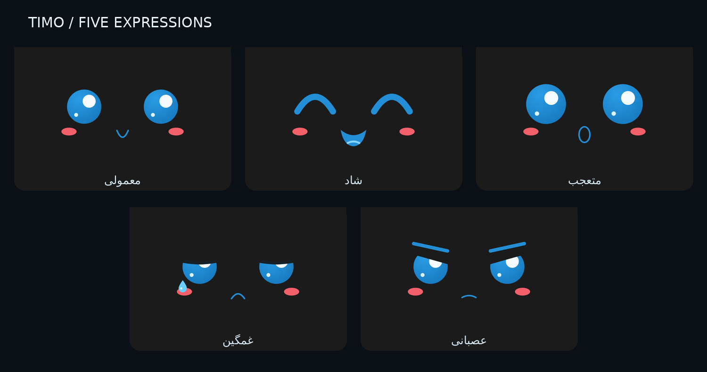
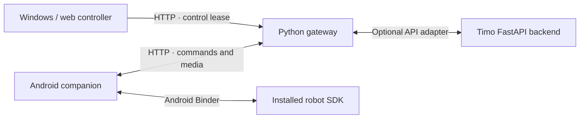

# Timo Remote

A teleoperation system for the Timo interactive robot. A Python gateway connects a Windows desktop controller and a browser panel to a Java companion app on the robot. The companion exchanges commands and status with the robot's installed SDK through Android Binder.

[راهنمای فارسی](README_FA.md) · [Run the demo](#demo-without-a-robot) · [Build the Android apps](#build-the-android-apps)



*Display assets from the Android companion. The local simulator below provides a synthetic camera feed for trying the controls.*

## What it does

- **Teleoperation.** Hold a direction to drive and release it to request a stop. The desktop and web controllers share a single control lease. The robot app checks command age and sequence numbers and can request a stop if the lease expires.
- **Camera and audio.** Preview JPEG frames, listen to the robot microphone and use push-to-talk to play audio through the robot speaker. Media buffers are bounded and stale frames expire.
- **Navigation and voice integration.** The optional FastAPI adapter reads rooms and map revisions from the main Timo project. The gateway revalidates the selected destination before delivery. The adapter also connects chat and text-to-speech.
- **Robot display and arm testing.** The offline face renderer has five expressions. The desktop provides a staged arm test for the supported SDK profile with explicit step confirmation. It reports requested targets and SDK responses.

## Architecture



| Component | Source | Responsibility |
| --- | --- | --- |
| Windows controller | [desktop.py](desktop.py) | Tkinter UI, held-direction controls, camera, audio and ADB setup |
| Gateway | [server.py](server.py) | Sessions, control lease, command queue, feedback and media |
| SDK bridge | [SdkBridge.java](android/robot/src/main/java/com/htnhome/timoremote/robot/SdkBridge.java) | Binder connection to the vendor service |
| Robot-side guards | [DriveGuard.java](android/robot/src/main/java/com/htnhome/timoremote/robot/DriveGuard.java), [NavigationControl.java](android/robot/src/main/java/com/htnhome/timoremote/robot/NavigationControl.java) | Command expiry, stop sequencing and navigation status |
| Assistant adapter | [project_link.py](project_link.py), [project_control.py](project_control.py) | Chat, speech and repeatable validation of room destinations |
| Browser and Android controller | [web/](web/), [android/controller/](android/controller/) | Browser UI and a native Android WebView wrapper |

## Demo without a robot

Use Python 3.11 or later. The simulator starts a loopback server and supplies synthetic camera frames and audio. The demo requires no ADB, Android SDK or assistant backend.

```bash
python -m pip install "Pillow>=10.4,<13"
python tests/demo_agent.py
```

Open [http://127.0.0.1:18765](http://127.0.0.1:18765) and enter `local-test-password`. Activate control, turn on the camera and hold a direction to see simulated command feedback. The demo password applies only to the local fixture.

## Run the Windows controller

1. Use Python 3.11 or later and run `Start_Windows.bat`. It creates a virtual environment and installs the desktop dependencies.
2. For a robot connection, build the robot APK and copy it to `apks/TimoRemote-Robot.apk`. Make the authorized device visible to `adb devices`.
3. In the desktop panel, select **اتصال ربات** (Connect robot). The first launch generates a local `config.json` for credentials and connection settings.

The gateway is designed for one robot on a trusted private network. Hardware integration depends on the device's installed vendor SDK and motion profile. SDK submission confirms that a request was passed to the SDK. Confirm actual movement and stopping on the device during hardware validation.

## Build the Android apps

Use JDK 17 and Android SDK Platform 35. From the `android` directory on Windows:

```cmd
gradlew.bat :robot:assembleDebug :controller:assembleDebug
```

On Linux or macOS use `./gradlew` with the same tasks. The debug APKs are created under `robot/build/outputs/apk/debug/` and `controller/build/outputs/apk/debug/`. Android's local debug key signs these builds. Updating an existing device installation requires the original signing key for that installation.

## Tests

```bash
python -m unittest discover -s tests -v
node tests/test_face_web.cjs
node tests/test_project_web.cjs
node tests/test_talk_web.cjs
```

The repository also includes Java tests for the drive, navigation, head and arm control logic using fake clocks and transports. See the [Persian guide](README_FA.md) for a walkthrough of the command path and test coverage.

Maintainer · **Babak Mojaver**
